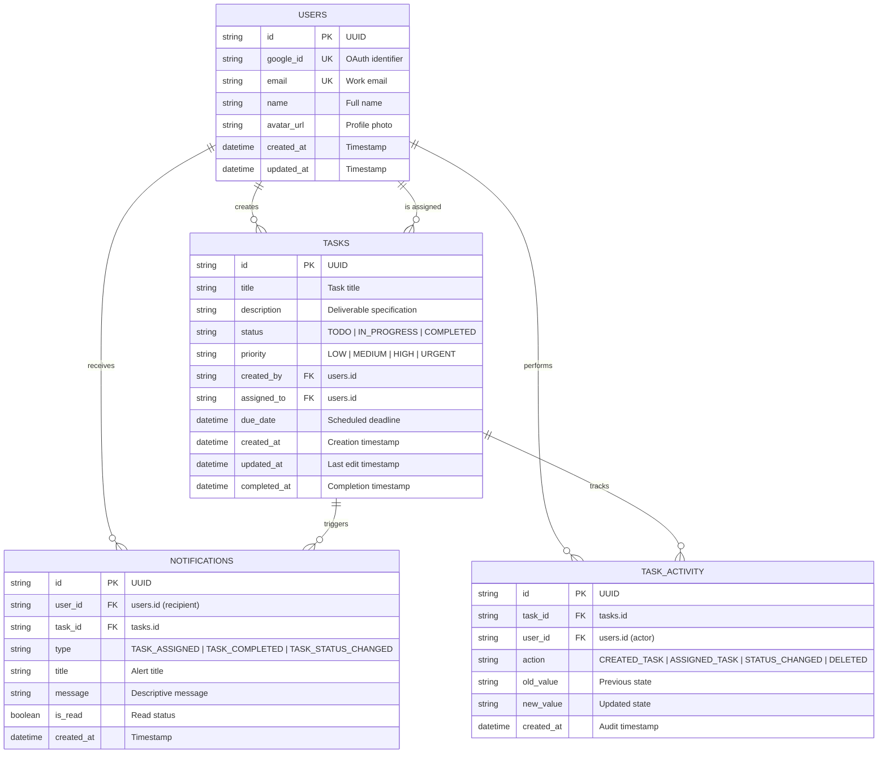
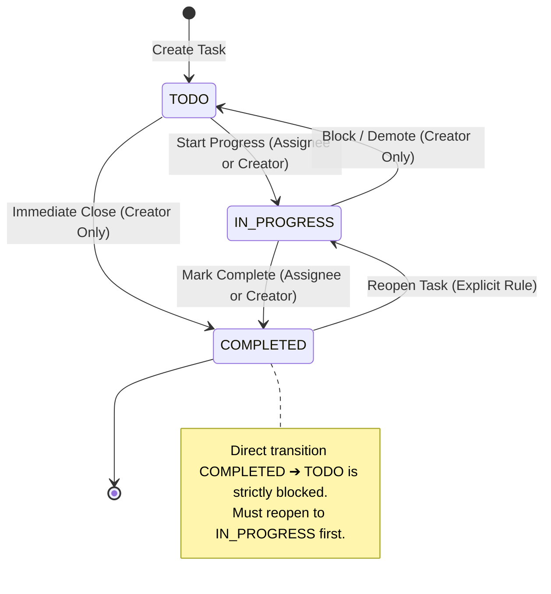

# Hairdrama Tech — Task Management System

An enterprise-grade, high-performance Task Management System built with a strict **Three-Layer Architecture**: **Next.js + TypeScript** (Presentation Layer), **Flask + Python** (Business / Application Layer), and **MongoDB** (Persistence Layer), integrated with **Google OAuth 2.0** and **Gmail API**.

[](backend/tests)
[](frontend)
[](backend)
[](docs/database.md)
[](LICENSE)

---

## 📑 Table of Contents
1. [Architecture Philosophy & Diagrams](#-architecture-philosophy--diagrams)
2. [Database Schema & ERD](#-database-schema--entity-relationships)
3. [Task State Machine](#-task-state-machine)
4. [Authorization & Security Matrix](#-authorization--security-matrix)
5. [Resilient Gmail Notification Architecture](#-resilient-gmail-notification-architecture)
6. [Key Features](#-key-features)
7. [Quick Start & Local Setup](#-quick-start--local-setup)
8. [Automated Testing Suite](#-automated-testing-suite)
9. [Two-User End-to-End Demonstration (Section 27)](#-two-user-end-to-end-demonstration-section-27)
10. [REST API Specification](#-rest-api-specification)
11. [Git Strategy (25 Milestones)](#-git-strategy-milestones)
12. [Interview Technical Summary](#-interview-technical-summary-section-35)

---

## 🏗️ Architecture Philosophy & Diagrams

The system follows a strict separation of concerns across three decoupled tiers. Business rules and permissions never leak into UI components, and presentation views never interact directly with database credentials.

### High-Level System Architecture

```mermaid
graph TB
    subgraph Client["Presentation Layer (Next.js 16 + TypeScript)"]
        Browser["User Browser / Desktop"]
        AuthUI["Auth & Personas"]
        Dashboard["Section 19 Dashboard"]
        Kanban["Kanban Board & Deliverables"]
        Modals["Task Details & Activity Audit"]
        NotifBell["Notification Center"]
        APIClient["lib/api.ts (Axios/Fetch Wrapper)"]
    end

    subgraph Backend["Application & Business Layer (Flask + Python)"]
        Routes["API Blueprints (/auth, /users, /tasks, /notifications)"]
        Middleware["Middleware (Auth, RBAC Matrix, Schema Validation, Error Handler)"]
        Services["Domain Services (TaskService, UserService, AuthService)"]
        EmailService["Decoupled EmailService"]
        Repos["Repository Layer (TaskRepo, UserRepo, NotifRepo, ActivityRepo)"]
    end

    subgraph External["External Services & Identity"]
        GoogleOAuth["Google OAuth 2.0 Provider"]
        GmailAPI["Google Gmail API (MIME / OAuth)"]
    end

    subgraph Database["Persistence Layer (MongoDB)"]
        UsersCol[("users")]
        TasksCol[("tasks")]
        NotifsCol[("notifications")]
        ActivityCol[("task_activity")]
    end

    Browser -->|HTTPS| AuthUI
    Browser -->|HTTPS| Dashboard
    Browser -->|HTTPS| Kanban

    AuthUI --> APIClient
    Dashboard --> APIClient
    Kanban --> APIClient
    Modals --> APIClient
    NotifBell --> APIClient

    APIClient -->|REST / Bearer JWT| Routes
    Routes --> Middleware
    Middleware --> Services
    Services --> Repos
    Services --> EmailService

    Services -.->|Authenticate Identity| GoogleOAuth
    EmailService -.->|Asynchronous Send| GmailAPI

    Repos --> UsersCol
    Repos --> TasksCol
    Repos --> NotifsCol
    Repos --> ActivityCol
```



### Complete System Topology Diagram

```
                                      ┌─────────────────────┐
                                      │       USER          │
                                      │ Browser / Desktop   │
                                      └──────────┬──────────┘
                                                 │
                                                 │ HTTPS
                                                 ▼
┌────────────────────────────────────────────────────────────────────┐
│                         VERCEL                                     │
│                     NEXT.JS FRONTEND                               │
│                     TypeScript + Tailwind CSS                      │
│                                                                    │
│  ┌────────────┐  ┌─────────────┐  ┌──────────────┐                 │
│  │ Auth UI    │  │ Dashboard   │  │ Kanban Board │                 │
│  └────────────┘  └─────────────┘  └──────────────┘                 │
│                                                                    │
│  ┌────────────┐  ┌─────────────┐  ┌──────────────┐                 │
│  │ Task Form  │  │ User Search │  │ Activity Log │                 │
│  └────────────┘  └─────────────┘  └──────────────┘                 │
└──────────────────────────────┬─────────────────────────────────────┘
                               │
                               │ REST API / HTTPS (Bearer JWT)
                               ▼
┌────────────────────────────────────────────────────────────────────┐
│                       RENDER / RAILWAY                             │
│                         FLASK API                                  │
│                                                                    │
│  ┌────────────────────────────────────────────────────────────┐    │
│  │                    API ROUTES                              │    │
│  │  /api/auth     /api/users     /api/tasks     /notifications│    │
│  └──────────────────────────┬─────────────────────────────────┘    │
│                             │                                      │
│                             ▼                                      │
│  ┌────────────────────────────────────────────────────────────┐    │
│  │                    MIDDLEWARE                              │    │
│  │  Authentication │ Authorization │ Validation │ ErrorHandler│    │
│  └──────────────────────────┬─────────────────────────────────┘    │
│                             │                                      │
│                             ▼                                      │
│  ┌────────────────────────────────────────────────────────────┐    │
│  │                     SERVICES                               │    │
│  │  Auth Service │ Task Service │ User Service │ Email Service│    │
│  └───────────────┬─────────────────────────────┬──────────────┘    │
│                  │                             │                   │
│                  ▼                             ▼                   │
│          ┌───────────────┐              ┌─────────────────┐        │
│          │ Repository    │              │ External APIs   │        │
│          │ Layer         │              │                 │        │
│          └───────┬───────┘              │ Google OAuth    │        │
│                  │                      │ Gmail API       │        │
│                  │                      └─────────────────┘        │
└──────────────────┼─────────────────────────────────────────────────┘
                   │
                   ▼
        ┌─────────────────────────┐
        │        MONGODB          │
        │                         │
        │ ┌─────────────────────┐ │
        │ │ users               │ │
        │ │ tasks               │ │
        │ │ notifications       │ │
        │ │ task_activity       │ │
        │ └─────────────────────┘ │
        └─────────────────────────┘
```

---

## 🗄️ Database Schema & Entity Relationships

The database is built on top of MongoDB collections with indexed foreign keys, compound indexes, and strict validation.



---

## 🔄 Task State Machine

Task transitions follow a deterministic state machine. Arbitrary status jumps (such as directly marking a completed task back to to-do without re-opening) are strictly rejected with code `INVALID_STATUS_TRANSITION`.



---

## 🛡️ Authorization & Security Matrix

Requests are strictly validated against an explicit permission matrix:

| Action | Creator | Assignee | Other User | Enforcement Middleware |
| :--- | :---: | :---: | :---: | :--- |
| **View task** | ✅ | ✅ | ❌ | `@require_task_permission("view")` |
| **Edit task details** | ✅ | ❌ | ❌ | `@require_task_permission("edit")` |
| **Change status** | ✅ | ✅ | ❌ | `@require_task_permission("change_status")` |
| **Reassign task** | ✅ | ❌ | ❌ | `@require_task_permission("assign")` |
| **Delete task** | ✅ | ❌ | ❌ | `@require_task_permission("delete")` |
| **View activity audit log**| ✅ | ✅ | ❌ | `@require_task_permission("view_activity")` |

---

## ✉️ Resilient Gmail Notification Architecture

Task creation and status progression **never** fail if external email delivery encounters intermittent network errors or rate limits.

```
Create Task / Update Status
           │
           ├── 1. Save to MongoDB ──────────────────► SUCCESS (Task Persisted)
           │
           └── 2. Trigger EmailService
                       │
                       ▼
                 Gmail API Call
                       │
                       ├── Success ─────────────────► Email Delivered to Assignee/Creator
                       └── Network/Rate Limit Error ─► Log Failure gracefully; Task remains intact!
```

Two required transactional emails:
1. **Assignment Notification**: Sent to assignee when assigned to a deliverable.
2. **Completion Notification**: Sent to creator when the assignee marks the deliverable complete.

---

## 🌟 Key Features

1. **Exact Section 19 Dashboard**:
   - Dynamic greeting banner: `Good morning, Abhishek 👋` / `Good morning, Rahul 👋`
   - **5 Stat Cards**: Total (`24`), To Do (`8`), Active (`6`), Done (`10`), Overdue (`2`)
   - Interactive filtering on stat card click
2. **Dedicated Kanban Board (Columns)**:
   - 📋 **To Do Column**
   - ⚡ **In Progress Column**
   - ✅ **Completed Column**
   - Instant toggle between **Board View** and **List / Grid View**
3. **Three Distinct Navigation Views**:
   - `My Tasks` (`/tasks?view=assigned`): Filtered to the logged-in user's tasks
   - `All Deliverables` (`/tasks?view=all`): Company-wide roadmap of all 24 deliverables
   - `Completed` (`/tasks?status=COMPLETED`): Specialized archive of completed work
4. **Activity Audit Trail**:
   - Full timeline with timestamps and actors for every create, reassign, and status transition
5. **Real-Time Notification Center**:
   - `NotificationBell` with unread count and popover list

---

## 🚀 Quick Start & Local Setup

### Prerequisites
- Node.js 18+ & npm
- Python 3.10+
- Local MongoDB or MongoDB Atlas URI

### 1. Clone & Setup Repository
```bash
git clone https://github.com/Abhishekchoudhary9622/Hairdrama.git
cd Hairdrama
```

### 2. Backend Setup
```bash
# Navigate to backend
cd backend

# Create virtual environment
python -m venv venv
# Windows:
.\venv\Scripts\activate
# macOS/Linux:
source venv/bin/activate

# Install dependencies
pip install -r requirements.txt

# Seed realistic database (4 users, 24 tasks, 74 activity logs, 10 notifications)
python migrations/seed_data.py

# Run Flask server (Default port: 5000)
python run.py
```

### 3. Frontend Setup
```bash
# Navigate to frontend
cd ../frontend

# Install dependencies
npm install

# Run development server (Default port: 3000)
npm run dev
```

Open [http://localhost:3000](http://localhost:3000) in your browser.

---

## 🧪 Automated Testing Suite

### Backend Pytest Suite (15/15 Passed)
```bash
pytest backend/tests -v
```
Test coverage includes:
- Authentication & Session Verification
- Task CRUD lifecycle
- Strict Role-Based Authorization Matrix
- State Machine Transition Validation
- Task Metrics & Overdue Calculation
- In-App Notifications & Activity Logging
- User Search & Profile Updates

### Frontend Compilation
```bash
cd frontend
npm run build
```
Validates zero TypeScript errors, valid JSX syntax, and static page generation.

---

## 👥 Two-User End-to-End Demonstration (Section 27)

To demonstrate the full interaction flow in under 2 minutes:

1. **Sign In**: Go to `http://localhost:3000/login` and click **Abhishek Verma (Product Manager)**.
2. **Create Task**:
   - Click `+ Create Task`.
   - Title: `Build high-throughput caching layer`
   - Priority: `HIGH`
   - Assignee: `Rahul Sharma`
   - Click **Create Task**.
3. **Switch Persona**:
   - Click the top-right profile pill and switch to **Rahul Sharma (Lead Engineer)**.
   - Observe the unread notification in the 🔔 bell.
4. **Update Status**:
   - Under `My Tasks`, click **Start Progress** (`TODO` ➔ `IN_PROGRESS`).
   - Click **Mark Completed** (`IN_PROGRESS` ➔ `COMPLETED`).
5. **Verify Creator Notification**:
   - Switch back to **Abhishek Verma**.
   - Notice the completion notification in the bell and inspect the **Activity Audit Trail** in the task modal!

---

## 📡 REST API Specification

### Authentication
- `GET /api/auth/google` — Get Google OAuth consent URL
- `GET /api/auth/google/callback` — OAuth redirect exchange & JWT session creation
- `POST /api/auth/dev-login` — Fast persona switcher for testing
- `GET /api/auth/me` — Get authenticated user details
- `POST /api/auth/logout` — Revoke active session

### Tasks
- `GET /api/tasks` — List tasks (`status`, `priority`, `assigned_to`, `search`, `view`)
- `POST /api/tasks` — Create new deliverable
- `GET /api/tasks/stats` — Aggregate counts (`total`, `todo`, `in_progress`, `completed`, `overdue`)
- `GET /api/tasks/:id` — Get task by ID (Enforces Creator/Assignee permission)
- `PATCH /api/tasks/:id` — Update task details (Creator only)
- `PATCH /api/tasks/:id/status` — Advance state machine
- `PATCH /api/tasks/:id/assign` — Reassign task (Creator only)
- `DELETE /api/tasks/:id` — Delete task (Creator only)
- `GET /api/tasks/:id/activity` — Retrieve immutable audit trail

### Notifications
- `GET /api/notifications` — Fetch in-app notifications
- `PATCH /api/notifications/:id/read` — Mark notification read
- `PATCH /api/notifications/read-all` — Mark all read

---

## 📜 Git Strategy Milestones

The repository maintains an incremental commit history:

| Step | Commit Milestone |
| :---: | :--- |
| **01** | `Initial project setup` |
| **02** | `Add Next.js frontend structure` |
| **03** | `Add Flask backend structure` |
| **04** | `Add database configuration and migrations` |
| **05** | `Add users schema and repository` |
| **06** | `Add tasks schema and repository` |
| **07** | `Add notifications repository` |
| **08** | `Add task activity repository` |
| **09** | `Implement Google OAuth` |
| **10** | `Add authentication middleware` |
| **11** | `Add user APIs` |
| **12** | `Add task creation API` |
| **13** | `Add task assignment` |
| **14** | `Add task status updates` |
| **15** | `Add Gmail service` |
| **16** | `Add task email notifications` |
| **17** | `Build dashboard UI` |
| **18** | `Build task management UI` |
| **19** | `Add search and filters` |
| **20** | `Add notification center` |
| **21** | `Add validation and error handling` |
| **22** | `Add tests` |
| **23** | `Fix production issues` |
| **24** | `Update documentation` |
| **25** | `Production deployment` |

---

## 🎤 Interview Technical Summary (Section 35)

> *"I designed the application using a three-layer architecture. Next.js handles the presentation layer, Flask handles the API and business logic, and MongoDB handles persistence via the repository pattern. Authentication is handled through Google OAuth 2.0 with cryptographically verified sessions. The Gmail API is decoupled into a resilient email service so task operations never depend synchronously on email delivery. Flask routes receive requests, authentication and authorization middleware enforces an explicit permission matrix, services handle domain logic, and repositories manage database operations. I also built an activity audit trail and in-app notifications to deliver an enterprise-grade experience."*

---

## 📄 License
This project is licensed under the MIT License - see the [LICENSE](LICENSE) file for details.
